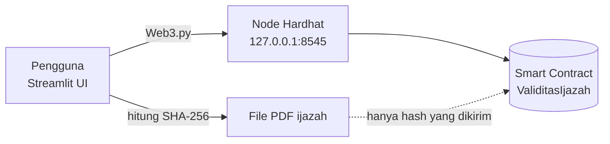

# 🎓 CekIjazah — Validasi Ijazah Berbasis Blockchain

Aplikasi untuk menerbitkan dan memverifikasi keaslian ijazah digital menggunakan **smart contract**.
Setiap ijazah dihitung sidik jari digitalnya (**SHA-256**) dari file PDF, lalu dicatat di blockchain.
Saat diverifikasi, sidik jari file yang diunggah dicocokkan dengan catatan itu. **Edit satu huruf saja, hasilnya langsung tidak cocok.**

> Proyek pembelajaran untuk praktikum Blockchain. Dibangun dengan Solidity, Hardhat, Web3.py, dan Streamlit.

---

## 📌 Latar Belakang

Ijazah adalah bukti resmi kelulusan yang dibutuhkan untuk melamar kerja dan melanjutkan studi, sehingga sering menjadi sasaran pemalsuan. Memalsukan dokumen digital kini mudah: cukup mengedit file PDF. Sementara itu, perusahaan harus menghubungi kampus secara manual untuk mengecek keasliannya, dan prosesnya lambat.

Proyek ini memakai blockchain yang catatannya permanen dan sulit diubah diam-diam. Yang dicatat hanya **sidik jari** dokumen, bukan filenya, sehingga verifikasi bisa dilakukan cepat oleh siapa saja.

---

## ✨ Fitur

| Peran | Fitur |
|---|---|
| 🏢 **Perusahaan / Umum** | Verifikasi ijazah tanpa wallet (nomor ijazah + PDF), hasil otomatis saat membuka tautan/QR, unduh bukti verifikasi |
| 🎒 **Mahasiswa** | Klaim ijazah dengan wallet yang terdaftar, bagikan tautan dan QR code verifikasi |
| 🏛️ **Kampus (Authority)** | Registrasi mahasiswa, terbitkan ijazah (hash PDF dihitung otomatis), cabut ijazah |
| 📊 **Dashboard** | Jumlah ijazah yang pernah terdaftar, mahasiswa teregistrasi, sudah diklaim, dicabut, plus riwayat penerbitan |

Hasil verifikasi punya empat kemungkinan:

| Hasil | Arti |
|---|---|
| ✅ **ASLI** | File cocok dengan yang diterbitkan kampus |
| ⚠️ **BEDA** | Nomor ijazah ada, tetapi isi file berbeda (kemungkinan diedit/dipalsukan) |
| ⛔ **DICABUT** | Ijazah sudah dicabut oleh penerbit |
| ❓ **NIHIL** | Nomor ijazah tidak ditemukan |

---

## 🧱 Arsitektur



- **Smart contract** menyimpan data mahasiswa, data ijazah, dan hash dokumen.
- **Web3.py** menghubungkan Streamlit ke node Hardhat dan memanggil fungsi kontrak.
- **File PDF tidak dikirim ke blockchain.** Hanya hash SHA-256-nya.

---

## 🛠️ Teknologi

- **Solidity 0.8.28** + **Hardhat** (jaringan lokal)
- **Python** + **Web3.py** (≥ 7.0)
- **Streamlit** (≥ 1.50) untuk antarmuka
- Opsional: `fpdf2` (bukti verifikasi PDF) dan `qrcode[pil]` (QR code)

---

## 📁 Struktur Proyek

```
ijazah/
├── contracts/
│   └── ValiditasIjazah.sol     # smart contract
├── scripts/
│   └── deploy.js               # deploy + tulis alamat ke deployment.json
├── ijazah_contoh/              # 3 PDF ijazah contoh untuk uji coba
├── app.py                      # aplikasi Streamlit
├── hardhat.config.js
├── package.json
├── deployment.json             # dibuat otomatis setelah deploy
└── README.md
```

---

## 🚀 Cara Menjalankan

### Prasyarat
- [Node.js](https://nodejs.org) (LTS)
- Python 3.10 atau lebih baru

### 1. Pasang dependensi

```bash
npm install
python -m pip install "streamlit>=1.50" "web3>=7.0" fpdf2 "qrcode[pil]"
```

### 2. Compile smart contract

```bash
npx hardhat compile
```

### 3. Nyalakan blockchain lokal (terminal 1, biarkan tetap berjalan)

```bash
npx hardhat node
```

### 4. Deploy kontrak (terminal 2)

```bash
npx hardhat run scripts/deploy.js --network localhost
```

Alamat kontrak otomatis tersimpan di `deployment.json`.

### 5. Jalankan aplikasi

```bash
streamlit run app.py
```

Buka `http://localhost:8501`. Alamat kontrak terisi otomatis dari `deployment.json`.

> **Setiap kali `hardhat node` di-restart**, jalankan deploy lagi, lalu klik tombol **🔄 Pakai alamat dari deployment.json** di sidebar.

---

## 🧪 Alur Uji Coba

Tiga PDF contoh ada di folder `ijazah_contoh/`. Data yang diisi di form:

| Nama | NIM | Nomor ijazah | IPK | Tanggal lulus | File |
|---|---|---|---|---|---|
| Fadrial Junyana Putra | 2108010031 | IJZ-2025-001 | 3.82 | 2025-08-20 | `Ijazah_Fadrial_Junyana_Putra.pdf` |
| Prama Abid Muzakki | 2108010042 | IJZ-2025-002 | 3.91 | 2025-08-20 | `Ijazah_Prama_Abid_Muzakki.pdf` |
| Taufik Arrokhman | 2108010057 | IJZ-2025-003 | 3.67 | 2025-08-20 | `Ijazah_Taufik_Arrokhman.pdf` |

Program studi: Teknik Informatika, tahun masuk 2021.

1. **Kampus** (Account #0): registrasi mahasiswa, lalu terbitkan ijazah dengan PDF yang sesuai.
2. **Mahasiswa** (pilih akun wallet yang didaftarkan): klaim ijazah, lalu buka tab *Bagikan* untuk mendapat tautan dan QR.
3. **Perusahaan**: buka tautan/QR, unggah PDF yang sama → **ASLI**. Unggah PDF yang sudah diedit atau ditukar → **BEDA**.
4. **Kampus**: cabut ijazah, lalu verifikasi ulang → **DICABUT**.
5. **Dashboard**: lihat jumlah ijazah yang terdaftar bertambah.

---

## 🔗 Hubungan UI dengan Smart Contract

| Fitur di UI | Fungsi kontrak | Catatan |
|---|---|---|
| Registrasi mahasiswa | `registrasiMahasiswa` | Hanya authority; NIM tidak boleh dobel |
| Terbitkan ijazah | `terbitkanIjazah` | Hash PDF dihitung di aplikasi; kontrak menolak hash kosong, hash dobel, dan IPK tidak valid |
| Klaim ijazah | `klaimIjazah` | Hanya wallet yang didaftarkan kampus |
| Cabut ijazah | `cabutIjazah` | Hanya authority; wajib ada alasan |
| Verifikasi | `cekStatusIjazah` | Fungsi view: gratis, tanpa wallet |
| Detail ijazah | `lihatDetailIjazah`, `lihatStatusIjazah` | Fungsi view |
| Cek peran kampus | `isAuthority`, `namaAuthority` | Akun bukan authority tidak bisa membuka fitur kampus |
| Dashboard | event `IjazahDiterbitkan`, `MahasiswaDiregistrasi` + fungsi view | Angka dibaca dari log event kontrak |

---

## 📱 Memakai QR Code dari HP

Alamat default QR memakai IP Wi-Fi laptop. Agar bisa discan dari HP:

1. HP dan laptop harus berada di **Wi-Fi yang sama**.
2. Izinkan Python di **firewall Windows** saat diminta.
3. Kalau mencoba di laptop yang sama, ganti alamat di aplikasi menjadi `http://localhost:8501`.

---

## ❓ Pemecahan Masalah

| Gejala | Solusi |
|---|---|
| Sidebar menampilkan "Belum terhubung" | Jalankan `npx hardhat node`, lalu refresh halaman |
| "Tidak ada kontrak di alamat ini" | Node pernah di-restart: deploy ulang, lalu klik **Pakai alamat dari deployment.json** |
| File ABI tidak ditemukan | Jalankan `npx hardhat compile` |
| Bukti verifikasi berupa `.txt`, bukan PDF | Pasang `fpdf2`: `python -m pip install fpdf2` |
| QR code tidak muncul | Pasang `qrcode`: `python -m pip install "qrcode[pil]"` |
| Tampilan warna kacau / mode gelap | Hentikan Streamlit, pastikan `.streamlit/config.toml` ada (dibuat otomatis), lalu jalankan ulang |
| Transaksi ditolak | Pastikan akun yang dipilih sesuai peran (Account #0 = authority) dan NIM sudah diregistrasi |

---

## ⚠️ Batasan

- Sistem membuktikan bahwa **file sama dengan yang diterbitkan kampus**. Sistem **tidak** membuktikan bahwa orang yang membawa berkas adalah pemilik ijazah, jadi tetap cocokkan nama dan NIM di hasil dengan identitas yang bersangkutan.
- Data detail ijazah (nama, NIM, IPK) dapat dibaca siapa saja yang memanggil kontrak. Untuk pengembangan lanjutan, hanya hash yang disimpan on-chain dan detail diberi izin akses oleh mahasiswa.
- Dijalankan di jaringan **lokal Hardhat**. Untuk jaringan sungguhan diperlukan wallet pengguna (misalnya MetaMask) dan pertimbangan biaya gas.
- PDF di `ijazah_contoh/` hanyalah dokumen contoh, bukan ijazah resmi.

---

## 🧭 Pengembangan Lanjutan

- Izin akses data oleh mahasiswa (privasi)
- Penandatanganan transaksi lewat MetaMask
- Penerbitan massal lewat CSV
- Penerapan di jaringan berizin atau Layer 2

---

## 👥 Tim

| Nama | NIM | Peran |
|---|---|---|
| _(isi nama)_ | _(isi NIM)_ | _(isi peran)_ |

🔗 Repositori: _(tempel tautan GitHub)_